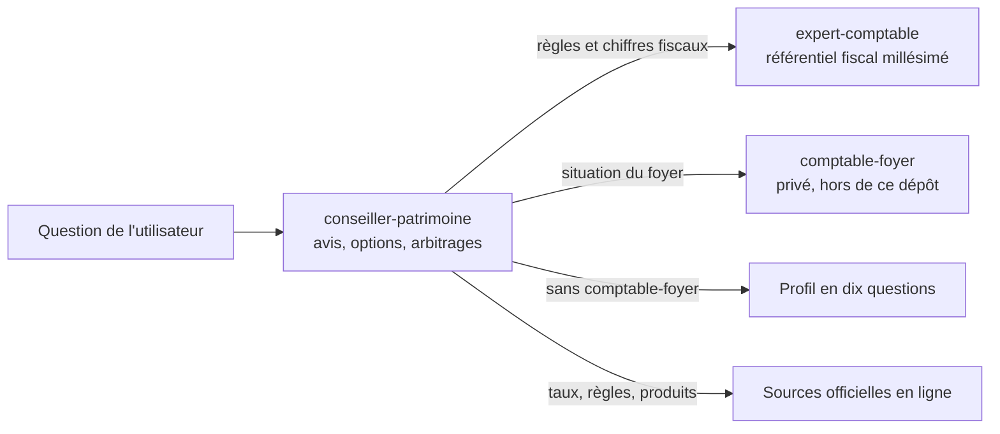

# Skill conseiller-patrimoine : guide complet

Un skill Claude qui joue le rôle d'un conseiller en gestion de patrimoine et en investissement pour un particulier ou un foyer en France. Il aide à décider : où placer une somme, comment répartir un PEA, acheter ou louer, combien emprunter, rembourser un prêt par anticipation, préparer la retraite ou les études des enfants. Il ne vend rien, il cite ses sources et il dit quand une idée est mauvaise.

Version : 2026-11-01 (1). Règles volatiles vérifiées le 01/11/2026. Relu par un agent indépendant le même jour. Aucune validation par un professionnel à ce stade.

Paquet prêt à installer : [`dist/conseiller-patrimoine.zip`](../dist/conseiller-patrimoine.zip). Sources du skill : [`.claude/skills/conseiller-patrimoine/`](../.claude/skills/conseiller-patrimoine/).

---

## Sommaire

1. [À lire avant toute utilisation](#1-à-lire-avant-toute-utilisation)
2. [Ce que fait le skill](#2-ce-que-fait-le-skill)
3. [Installation](#3-installation)
4. [Comment il raisonne](#4-comment-il-raisonne)
5. [L'information de première main](#5-linformation-de-première-main)
6. [Les trois skills et leur articulation](#6-les-trois-skills-et-leur-articulation)
7. [Contenu du dossier](#7-contenu-du-dossier)
8. [Les références](#8-les-références)
9. [Les scripts de calcul](#9-les-scripts-de-calcul)
10. [Tests et évaluations](#10-tests-et-évaluations)
11. [Ce qui a été vérifié, ce qui reste incertain](#11-ce-qui-a-été-vérifié-ce-qui-reste-incertain)
12. [Maintenance et mises à jour](#12-maintenance-et-mises-à-jour)
13. [Signaler une erreur, contribuer](#13-signaler-une-erreur-contribuer)
14. [Historique des versions](#14-historique-des-versions)

---

## 1. À lire avant toute utilisation

- **C'est une aide à la décision, pas un conseil réglementé.** Le skill n'est pas un conseiller en investissements financiers (CIF, CMF art. L541-1), ni un notaire, ni un expert-comptable. Il le rappelle dans sa première réponse de conseil.
- **Les règles changent.** Taux, plafonds, normes de crédit, calendrier énergétique des logements, retraite : le skill les revérifie en ligne avant une décision. L'état vérifié au 01/11/2026 est dans [`references/01-fraicheur.md`](../.claude/skills/conseiller-patrimoine/references/01-fraicheur.md).
- **Les projections reposent sur des hypothèses.** Les scripts n'ont aucun rendement par défaut : chaque hypothèse est fournie, sourcée, et testée en plusieurs scénarios.
- **Aucune donnée personnelle dans le skill.** Il se partage tel quel. Les données d'un foyer restent chez ce foyer.
- **Pour un enjeu important** (achat immobilier, donation, régime matrimonial, grosse somme), le skill prépare les questions et les chiffres ; le professionnel compétent valide.

---

## 2. Ce que fait le skill

### Domaines couverts

| Domaine | Exemples de questions |
|---|---|
| Placements et enveloppes | Livrets, PEA, assurance-vie, PER, épargne salariale (PEE, PERCOL, déblocages), compte-titres, épargne des enfants |
| Allocation et ETF | Monde, Europe, émergents, obligations, monétaire ; choix d'un ETF ; rééquilibrage par les versements ; investir une grosse somme |
| Immobilier et crédit | Capacité d'emprunt (normes HCSF), apport, achat-revente et prêt relais, remboursement anticipé, assurance emprunteur, louer ou acheter, investissement locatif, DPE, encadrement des loyers |
| Retraite | Âge de départ, estimation des droits, écart à combler, capital nécessaire, rente ou capital |
| Protection et transmission | Prévoyance, régime matrimonial, emploi et remploi, clause bénéficiaire, enfants mineurs, indivision |
| Placements alternatifs | Non coté, SCPI, financement participatif, crypto-actifs, or, produits structurés, défiscalisation |
| Méthode | Bilan patrimonial, charte d'investissement, journal des décisions, revue annuelle |

### Exemples à copier-coller

```
« J'ai 60 000 € disponibles sur mon PEE. On veut acheter un appartement d'ici deux ans. Je mets tout sur mon PEA ? »
« On gagne 7 000 € net par mois à deux, 650 € de crédit locatif et 800 € de loyers. Combien peut-on emprunter sur 25 ans ? »
« Il me reste 200 000 € sur un prêt à 1,2 % pendant 18 ans. Je rembourse 50 000 € par anticipation ? »
« Mon beau-frère me conseille une SCPI qui distribue 6 %. J'y mets 30 000 € ? »
« Mon PEA est à 100 % sur un ETF monde. Comment ajouter de l'Europe et des émergents sans rien vendre ? »
« Je suis né en 1979, salarié du privé. À quel âge puis-je partir à taux plein ? »
« Fais-nous un bilan patrimonial et une charte d'investissement. »
```

### Ce qu'il ne fait pas

- Pas de prévision de marché à court terme, pas de pari sur l'actualité.
- Pas de recommandation d'un produit sans l'avoir comparé à une alternative simple et sans avoir lu sa documentation officielle.
- Pas de calcul fiscal détaillé : il délègue au skill `expert-comptable` de ce dépôt.
- Pas d'accès aux comptes bancaires, pas d'ordre de bourse, pas de souscription.

---

## 3. Installation

### Sur claude.ai (web, bureau, mobile)

1. Télécharger [`dist/conseiller-patrimoine.zip`](../dist/conseiller-patrimoine.zip).
2. Dans claude.ai : **Settings** > **Capabilities** > **Upload skill**, choisir le zip.
3. Installer aussi [`dist/expert-comptable.zip`](../dist/expert-comptable.zip) : le conseiller lui délègue toute la fiscalité. Sans lui, il le dit et cherche la règle fiscale sur les sites officiels, avec la mention « hors corpus ».
4. Vérifier que la recherche web est activée : le skill en a besoin pour lire les sources officielles.

Le skill se déclenche seul dès qu'une question demande un avis ou un arbitrage sur l'argent du foyer. On peut aussi le nommer : « avec le skill conseiller-patrimoine, … ».

### Dans Claude Code

```bash
git clone https://github.com/joachimpomme-ctrl/comptable.git
cd comptable
claude
```

Les deux skills du dépôt (`.claude/skills/expert-comptable/` et `.claude/skills/conseiller-patrimoine/`) sont chargés automatiquement.

### Mettre à jour

Il n'y a pas de mise à jour automatique d'un skill importé. Quand une nouvelle version est publiée dans `dist/`, supprimer l'ancien skill et réimporter le zip. La version figure à la fin du `SKILL.md` (section Maintenance).

---

## 4. Comment il raisonne

### Quatre sources, jamais mélangées

| Besoin | D'où vient l'information |
|---|---|
| Situation du foyer (revenus, prêts, épargne, biens) | Le skill privé `comptable-foyer` s'il existe, sinon un profil en dix questions au plus |
| Objectifs et règles du foyer | La charte d'investissement du foyer |
| Règles et chiffres fiscaux | Le skill `expert-comptable` (référentiel millésimé et sourcé) |
| Règles non fiscales, taux, données de marché, caractéristiques d'un produit | Les sources de première main, lues pendant la session, avec date et lien |

### Déroulé d'une décision

1. **Qualifier** la demande : simple information (réponse directe et sourcée), décision, bilan ou revue.
2. **Charger le contexte** : situation, charte, horizon de chaque objectif, besoin de liquidité, régime matrimonial.
3. **Vérifier les règles en jeu**, revérifier celles qui sont périmées ou en mouvement.
4. **Chiffrer avec les scripts**, jamais de tête, en au moins trois scénarios dès que les marchés entrent en jeu.
5. **Comparer au moins deux options plus le statu quo** : résultat attendu, pire cas plausible, liquidité, réversibilité, coût complet, conformité à la charte.
6. **Écrire le contre-argument** à l'option qui paraît la meilleure, puis faire un pré-mortem.
7. **Donner un avis conditionnel**, avec un niveau de confiance (sûr, probable, hypothèse) et ce qui ferait changer d'avis.
8. **Rappeler les règles de décision** de la charte (seuil, délai de réflexion, décision à deux) et proposer la ligne du journal des décisions.
9. **Fixer la suite** : action concrète, date de revue, signal à surveiller.

### Format d'une réponse de décision

```
Question : une phrase.
Données : source et date.
Règles vérifiées : règle, valeur, source, date, statut.
Options : tableau (résultat attendu, pire cas, liquidité, réversibilité, coût, charte).
Contre-argument : l'objection la plus forte.
Avis : recommandation conditionnelle, confiance, ce qui ferait changer d'avis.
À décider : ce qui reste à trancher, par qui, avant quand.
Sources : liens.
```

### Principes de fond

Détail, références académiques et statut de chaque principe (consensus, large accord, débattu, heuristique) dans [`references/02-doctrine.md`](../.claude/skills/conseiller-patrimoine/references/02-doctrine.md). En résumé :

- **Règle d'horizon (heuristique)** : moins de 5 ans, pas d'actions ; 5 à 8 ans, part d'actions limitée et décroissante ; plus de 8 ans, actions diversifiées. L'indice MSCI World a perdu environ 57 % en dollars d'octobre 2007 à mars 2009.
- La concentration (action de l'employeur, un seul bien, un seul pays) est un risque non rémunéré.
- Les frais se composent : un point de frais annuel en moins vaut plus que presque tout pronostic.
- Personne ne prévoit les marchés de façon fiable : règles écrites, versements programmés, rééquilibrage par les flux.
- Une dette se compare au rendement sans risque de même horizon, pas au rendement espéré des actions.
- L'enveloppe fiscale vient après le choix de l'actif.
- Le premier risque est le comportement : la charte, le délai et le journal protègent mieux que la prévision.

---

## 5. L'information de première main

C'est le cœur du skill : aucun chiffre volatil de mémoire.

### Hiérarchie des sources

| Rang | Ce que c'est | Exemples | Statut d'un chiffre lu là |
|---|---|---|---|
| 1 | Le texte ou le producteur de la donnée | Légifrance, Journal officiel, BOFiP, HCSF, AMF, ACPR, BCE, INSEE, Banque de France, DIC et prospectus d'un fonds, fiche d'un indice, rapport annuel d'une société | Sûr, avec date |
| 2 | Vulgarisation publique | service-public.gouv.fr, impots.gouv.fr, info-retraite.fr, ANIL, ABE Info Service, lafinancepourtous.com | Sûr si daté et cohérent, probable sinon |
| 3 | Presse et bases privées | Les Échos, L'AGEFI, MoneyVox, justETF, Quantalys, Morningstar | Probable si deux sources concordent, hypothèse sinon |
| 4 | Forums, réseaux sociaux, vidéos, IA | | Jamais une source de chiffre |

La carte complète, sujet par sujet (droit, taux, produits, autorisations anti-arnaque, immobilier, retraite, recherche académique), est dans [`references/00-sources.md`](../.claude/skills/conseiller-patrimoine/references/00-sources.md).

### Protocole

1. Identifier la source de premier rang.
2. La trouver par une recherche web, la lire.
3. Citer la valeur, sa date d'effet, la date de consultation et le lien.
4. Si la page officielle est illisible pour l'outil, deux sources secondaires datées et concordantes donnent le statut « probable ».
5. En cas de désaccord, le texte officiel prime, puis la date d'effet la plus récente, et l'écart est signalé.
6. Un texte en discussion au Parlement n'est pas du droit en vigueur.

### Limites techniques connues

- Le shell de l'environnement Claude n'a en général pas d'accès réseau : les données se lisent par les outils de recherche et de lecture web, pas par des scripts.
- Certaines sources bloquent la lecture automatique (API de la BCE, certaines pages d'economie.gouv.fr ou de Légifrance). Le skill le dit et se rabat sur des sources de rang 2 ou 3 datées.
- Si un connecteur de données financières ou bancaires est disponible dans Claude, il devient une source de premier rang pour ce qu'il couvre.

---

## 6. Les trois skills et leur articulation



| Skill | Rôle | Où |
|---|---|---|
| `expert-comptable` | Règles fiscales et comptables, référentiel de paramètres sourcés | Ce dépôt, public |
| `conseiller-patrimoine` | Conseil, arbitrages, méthode, calculs, sources de première main | Ce dépôt, public |
| `comptable-foyer` | Données et opérations d'un foyer précis (fiche patrimoniale, registre des flux) | Privé, propre à chaque foyer, jamais dans ce dépôt |

Un ami qui installe seulement `conseiller-patrimoine` et `expert-comptable` répond à dix questions de profil (gabarit dans [`references/10-methode-gabarits.md`](../.claude/skills/conseiller-patrimoine/references/10-methode-gabarits.md)). Le skill propose de garder ce profil dans un document qui lui appartient, daté, à mettre à jour une fois par an.

---

## 7. Contenu du dossier

```
.claude/skills/conseiller-patrimoine/
  SKILL.md                         <- protocole, règles, index (chargé par Claude)
  references/                      <- base de connaissances, chargée à la demande
    00-sources.md                  <- carte des sources de première main
    01-fraicheur.md                <- règles volatiles : valeur, source, date, statut
    02-doctrine.md                 <- ce que la recherche établit, avec références
    03-enveloppes.md               <- livrets, PEA, assurance-vie, PER, épargne salariale
    04-allocation-etf.md           <- allocation, ETF, rééquilibrage, grosse somme
    05-immobilier-credit.md        <- achat, revente, crédit, locatif, DPE
    06-retraite.md                 <- système, droits, écart, capital, rente
    07-protection-transmission.md  <- prévoyance, régime matrimonial, clauses
    08-alternatifs.md              <- non coté, SCPI, crypto, or, structurés
    09-comportement-garde-fous.md  <- biais, arnaques, conflits d'intérêts, DIC
    10-methode-gabarits.md         <- profil, bilan, charte, journal, revue
  scripts/                         <- calculs, Python 3 standard, sans dépendance
    credit.py  capacite.py  projection.py  tri.py  allocation.py  louer_acheter.py
    tests/test_calculs.py          <- 32 tests unitaires
  evals/                           <- 7 cas d'évaluation (non inclus dans le paquet)
```

---

## 8. Les références

| Fichier | Ce qu'on y trouve |
|---|---|
| `00-sources.md` | Hiérarchie des sources ; adresses par sujet : droit et fiscalité, taux et crédit, produits financiers (ISIN, DIC, GECO, fiches d'indices), autorisations (AMF, ACPR, ORIAS, REGAFI, MiCA, garantie des dépôts), immobilier (DVF, notaires, ANIL, ADEME), retraite, recherche académique |
| `01-fraicheur.md` | Normes HCSF, plafond des IRA, loi Lemoine, droits de mutation, calendrier DPE et réforme en cours, encadrement des loyers, statut du bailleur privé, plafonds des enveloppes, frais du PEA, prélèvements sociaux 2026, PER 2026, garantie des dépôts, crypto-actifs MiCA, retraite après la suspension de la réforme |
| `02-doctrine.md` | Une trentaine de résultats de recherche (Markowitz, Sharpe, Fama et French, Bessembinder, Dimson, Marsh et Staunton, Jordà et coauteurs, Bengen, Barber et Odean, Kahneman et Tversky, etc.), chacun avec son statut |
| `03-enveloppes.md` | Règles de fonctionnement : blocage, retraits, transferts, cas de déblocage, délais, arbre de décision pour une somme à placer |
| `04-allocation-etf.md` | Construire une allocation en cinq étapes, exposition géographique, neuf critères de choix d'un ETF, poche sans risque, rééquilibrage, investissement d'une grosse somme, signaux d'alerte |
| `05-immobilier-credit.md` | Budget d'achat, normes d'octroi, acheter avant de vendre ou l'inverse, prêt relais, transférabilité d'un prêt, leviers et pièges du crédit, garde-fous de calendrier, achat à deux hors communauté, louer ou acheter, valoriser un bien, investissement locatif |
| `06-retraite.md` | Architecture des régimes, notions clés, estimer ses droits, calculer l'écart à combler, rente ou capital, âge de départ |
| `07-protection-transmission.md` | Prévoyance, régime matrimonial, emploi et remploi, conjoint survivant, PACS et concubinage, enfants mineurs, documents à tenir à jour |
| `08-alternatifs.md` | Ce que dit la recherche et les questions à poser pour chaque placement alternatif ; règle « on achète un actif, pas une réduction d'impôt » |
| `09-comportement-garde-fous.md` | Dix biais et leur parade, signaux d'arnaque et vérifications, conflits d'intérêts, lecture d'un DIC, décider à deux |
| `10-methode-gabarits.md` | Profil en dix questions, bilan patrimonial, charte d'investissement, journal des décisions, revue annuelle de janvier, exemples de réponses |

---

## 9. Les scripts de calcul

Python 3.8 ou plus, bibliothèque standard uniquement. Chaque commande accepte `--help`. Montants en euros, taux en % annuel. Exemples lancés depuis le dossier du skill.

### `credit.py` : crédit à taux fixe

```bash
python scripts/credit.py mensualite --capital 300000 --taux 3.5 --duree-mois 300 --assurance-mensuelle 75
python scripts/credit.py empruntable --mensualite 1800 --taux 3.5 --duree-mois 300
python scripts/credit.py crd --capital 300000 --taux 3.5 --duree-mois 300 --apres 24
python scripts/credit.py tableau --capital 300000 --taux 3.5 --duree-mois 300 --csv tableau.csv
python scripts/credit.py ira --rembourse 50000 --crd-avant 200000 --taux 2.5
python scripts/credit.py anticipation --crd 200000 --taux 1.2 --mois-restants 216 \
    --montant 50000 --rendement-net 2.0 --mode duree --assurance-mensuelle 62.5
```

- `ira` applique le plafond légal (C. consom. art. R313-25) : le plus faible de six mois d'intérêts sur le capital remboursé et de 3 % du capital restant dû.
- `anticipation` compare, à la date de fin initiale du prêt, le patrimoine obtenu en remboursant (mensualités libérées placées) et en plaçant la somme. Mode `duree` (mensualité gardée, prêt raccourci) ou `mensualite` (durée gardée). En mode `duree`, l'assurance cesse avec le prêt : la renseigner.

### `capacite.py` : capacité d'emprunt et achat-revente

```bash
python scripts/capacite.py simple --revenus 7000 --taux 3.5 --duree-mois 300 \
    --assurance-taux 0.30 --apport 150000 --frais-acquisition-pct 7.5 --impot-mensuel 900 --charges-fixes 2500
python scripts/capacite.py achat-revente --revenus 7000 --charges-credit 650 --loyers 800 \
    --taux 3.5 --duree-mois 300 --assurance-taux 0.30 --frais-acquisition-pct 7.5 \
    --valeur-vente 400000 --crd-a-solder 250000 --frais-vente 5000 --epargne-apport 50000 \
    --quotite-relais 0.7 --taux-relais 4.0 --mensualite-actuelle 1500 --decote-scenario 10
```

- Taux d'effort maximal (35 % par défaut), part des loyers retenue (70 % par défaut, pratique bancaire à confirmer) : paramètres modifiables.
- `achat-revente` chiffre un scénario central et un scénario de vente décotée, vérifie que la vente couvre relais et capital restant dû, et donne le coût du portage à 6, 12 et 24 mois. La charge de trésorerie pendant le portage n'est pas le taux d'effort HCSF.

### `projection.py` : épargne et retraite

```bash
python scripts/projection.py epargne --capital 20000 --versement 1500 --annees 15 --rendements 1,3,5 --indexation 2 --inflation 2
python scripts/projection.py montecarlo --capital 20000 --versement 1500 --annees 15 \
    --rendement-moyen 5 --volatilite 15 --objectif 400000 --simulations 20000 --graine 1
python scripts/projection.py retraite --revenu-cible 5500 --pensions 3800 --taux-retrait 3,3.5,4 --taux-prelevement-retraits 10
python scripts/projection.py retrait-mc --capital 600000 --retrait-annuel 21000 --annees 30 --rendement-moyen 3 --volatilite 12
```

- Aucune hypothèse par défaut. `montecarlo` attend une moyenne arithmétique, `epargne` un taux composé : ne pas saisir le même chiffre (moyenne arithmétique ≈ taux composé + volatilité²/2).
- En rendement réel, les résultats sont en euros d'aujourd'hui.

### `tri.py` : rendement réel d'un placement

```bash
python scripts/tri.py xirr --flux "2021-01-15:-10000,2022-03-01:-5000,2026-11-01:19500"
python scripts/tri.py xirr --csv flux.csv
python scripts/tri.py annualise --initial 10000 --final 16000 --annees 6.5
```

Versements en négatif, retraits et valeur finale en positif. Le CSV (`date;montant`) accepte les formats français (espaces insécables, `1.234,56`).

### `allocation.py` : exposition et rééquilibrage

```bash
python scripts/allocation.py portefeuille.json
python scripts/allocation.py portefeuille.json --arbitrage --versement 2000
```

Le fichier JSON liste les positions (valeur, ventilation par zone tirée de la fiche de l'ETF, avec source et date), la cible et le versement du mois. Le script donne l'exposition réelle par zone, l'écart à la cible, la répartition du versement qui rapproche de la cible sans rien vendre, et les arbitrages complets si on veut revenir exactement à la cible. Modèle de fichier en tête du script.

### `louer_acheter.py` : louer ou acheter

```bash
python scripts/louer_acheter.py --prix 450000 --frais-acquisition-pct 7.5 --apport 120000 \
    --taux 3.5 --duree-mois 300 --assurance-mensuelle 60 --taxe-fonciere 1500 \
    --entretien-pct 1.0 --valorisation-pct 1.5 --frais-revente-pct 5 \
    --loyer 1500 --hausse-loyer-pct 1.5 --rendement-placement-pct 4 --horizon 15
```

Compare année par année le patrimoine net de l'acheteur (revente nette moins capital restant dû, plus son épargne) et celui du locataire (apport et différences de budget placés), et donne l'année de bascule.

---

## 10. Tests et évaluations

### Tests unitaires

```bash
python .claude/skills/conseiller-patrimoine/scripts/tests/test_calculs.py
```

32 tests sur des valeurs de référence : mensualité publiée par les simulateurs bancaires (200 000 € à 3 % sur 20 ans = 1 109,20 €), formule de rente, équivalence remboursement et placement au même taux, plafond des IRA, TRI sur années normales et bissextiles, répartition d'un versement, apport excédentaire, lecture des montants au format français. Ils tournent à chaque push via GitHub Actions (`.github/workflows/tests.yml`).

### Cas d'évaluation

Sept cas dans [`evals/`](../.claude/skills/conseiller-patrimoine/evals/), au format lu par `claude plugin eval` : une question, la description du résultat attendu et des critères vérifiables.

| Cas | Ce qu'il vérifie |
|---|---|
| `taux-livret-a-source` | Un taux donné avec sa source officielle et sa date, sans gabarit superflu |
| `pee-vers-pea-ou-apport` | Règle des 5 ans du PEA, horizon de l'apport, concentration sur l'employeur, options, contre-argument, confiance |
| `capacite-emprunt-calcul` | Usage de `capacite.py`, règle HCSF datée, taux non inventé |
| `scpi-recommandee-par-proche` | Vérification AMF, distribution contre rendement global, liquidité, alternative simple |
| `rembourser-pret-bas-taux` | Usage de `credit.py`, comparaison au sans-risque, liquidité, IRA |
| `age-depart-retraite` | info-retraite.fr, taux plein à 67 ans, incertitude réglementaire datée |
| `crypto-poche-plaisir` | Part du patrimoine calculée, prestataire agréé MiCA, plafond de poche |

Lancer avec Claude Code (exécutions facturées) depuis le dossier du skill :

```bash
cd .claude/skills/conseiller-patrimoine
claude plugin eval . --allow-tools Bash,WebSearch,WebFetch
```

---

## 11. Ce qui a été vérifié, ce qui reste incertain

### Vérification du 01/11/2026

Les règles volatiles ont été vérifiées en ligne le 01/11/2026 : normes HCSF (maintenues à la séance du 15/09/2026), calendrier DPE et projet de loi logement (adopté au Sénat le 08/07/2026, en cours), encadrement des loyers (expérimentation qui finit vers le 24/11/2026, prolongation votée au Sénat le 21/10/2026, deuxième lecture à l'Assemblée annoncée le 19/11/2026), suspension de la réforme des retraites, prélèvements sociaux 2026, fin du régime PSAN, coefficient électrique du DPE, droits de mutation, frais du PEA. Chaque ligne de `01-fraicheur.md` porte sa source, sa date et son statut.

### Relecture indépendante

Un agent séparé, sans accès au raisonnement de rédaction, a relu tout le skill le 01/11/2026 avec vérification en ligne. Il a relevé 13 erreurs, toutes corrigées :

1. Le statut du bailleur privé (dit Jeanbrun) était décrit comme « en discussion » alors qu'il a été créé par la loi de finances pour 2026.
2. Le pire cas des actions était sous-estimé (le MSCI World a perdu environ 57 % de 2007 à 2009).
3. Emploi et remploi : un bien acquis avec des fonds propres est propre ou commun en totalité, jamais en partie (C. civ. art. 1436).
4. Le calcul de remboursement anticipé oubliait l'assurance économisée quand le prêt finit plus tôt.
5. Prélèvements sociaux 2026 : liste incomplète (PER, épargne salariale, location meublée, CEL, PEP) et date d'application imprécise.
6. Trois assouplissements HCSF de décembre 2023 manquaient (prêt relais, seuil de travaux de 10 %, appréciation sur trois trimestres).
7. Les IRA étaient dites « souvent exclues en cas de vente » : elles sont dues en principe, sauf cas légaux.
8. Le taux du PEL n'est pas révisé au 1er février et au 1er août, mais une fois par an.
9. Le privilège de prêteur de deniers a été renommé en 2022.
10. Le reste à vivre ignorait l'impôt et les charges des biens loués.
11. Le script louer ou acheter perdait l'apport excédentaire.
12. Une référence sur le CAPE était mal utilisée.
13. Trois chiffres mineurs étaient mal repris (crypto-actifs, McLean et Pontiff, formule attribuée à Markowitz).

Ajouts issus de la relecture : garantie des dépôts et des contrats, délai de six mois pour un déblocage anticipé du PEE, clause bénéficiaire hors mariage, achat en indivision, nouveautés PER 2026, remboursement partiel minimal, garde-fous de calendrier d'un achat, lecture des montants au format français.

### Ce qui reste incertain

- Aucune règle n'a été validée par un professionnel.
- Plusieurs lignes de `01-fraicheur.md` sont « probables » (sources secondaires concordantes, texte officiel non relu par l'outil) ou « en mouvement » (textes en discussion).
- Les références académiques ont été vérifiées sur la mémoire de l'agent relecteur, pas toutes relues à la source.

---

## 12. Maintenance et mises à jour

### Calendrier

| Quand | Quoi |
|---|---|
| À chaque usage | Revérifier toute ligne de `01-fraicheur.md` périmée ou « en mouvement » avant une décision |
| Janvier | Lois de finances et de financement de la sécurité sociale : plafonds, prélèvements sociaux, PER, dispositifs fiscaux, retraite |
| Juillet | Taux réglementés, textes votés au printemps, normes HCSF |
| Après un vote attendu | Exemple : encadrement des loyers après le 19/11/2026, projet de loi logement |

### Procédure de mise à jour

1. Modifier les fichiers dans `.claude/skills/conseiller-patrimoine/` (en priorité `references/01-fraicheur.md`, avec source, date et statut).
2. Lancer les tests : `python .claude/skills/conseiller-patrimoine/scripts/tests/test_calculs.py`.
3. Mettre à jour la version et le résumé des changements à la fin du `SKILL.md` et dans la section 14 de ce guide.
4. Reconstruire le paquet : `python3 scripts/build_skill_package.py conseiller-patrimoine`.
5. Committer le skill et `dist/`, puis prévenir les utilisateurs : ils doivent réimporter le zip.

### Règles de rédaction du skill

- Aucun chiffre volatil sans source, date et statut.
- Aucune donnée personnelle.
- Une heuristique se dit heuristique.
- Le fiscal reste dans `expert-comptable`.

---

## 13. Signaler une erreur, contribuer

Une issue GitHub suffit, aucune connaissance de Git n'est nécessaire. Titres conseillés :

- `[CONSEILLER] <fichier ou sujet>` : erreur de fond, règle périmée, garde-fou manquant. Donner la source officielle qui montre l'erreur.
- `[FRAICHEUR] <règle>` : une règle de `01-fraicheur.md` a changé (nouveau texte, nouvelle date).
- `[CAS DE TEST] conseiller` : une question réelle anonymisée avec ce que la bonne réponse doit contenir.

Les professionnels (CGP, CIF, notaires, courtiers, experts-comptables) sont particulièrement bienvenus pour relire `01-fraicheur.md`, `03-enveloppes.md`, `05-immobilier-credit.md` et `07-protection-transmission.md`. Voir aussi [CONTRIBUTING.md](../CONTRIBUTING.md).

---

## 14. Historique des versions

| Version | Date | Changements |
|---|---|---|
| 2026-11-01 (1) | 01/11/2026 | Première version publique. Protocole de décision, carte des sources de première main, 11 références, 6 scripts et 32 tests, 7 cas d'évaluation. Règles volatiles vérifiées le jour même. Relecture indépendante : 13 erreurs corrigées et compléments ajoutés (section 11). |
